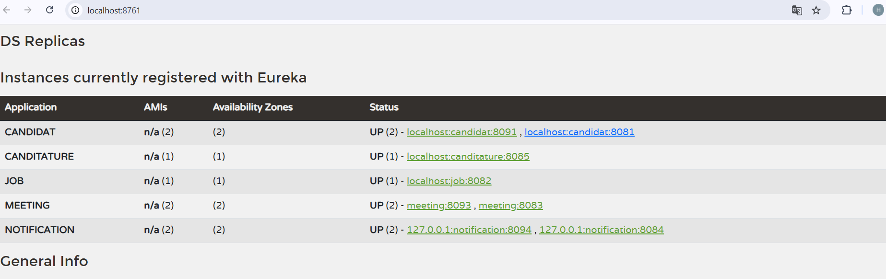

# Atelier Eureka – Architecture Web Distribuée

Année universitaire 2026-2027

## Équipe
- Hiba Ben Amara
- Leila Jendoubi
- Adem Hchicha
- Aziz Jouini

## Description
Mise en place d'un serveur de découverte **Eureka** (Spring Cloud Netflix) auquel
s'enregistrent des microservices écrits dans trois technologies différentes
(Spring Boot, Node.js, Python).

## Architecture

| Microservice | Technologie | Port | Nom dans Eureka |
|---|---|---|---|
| Eureka Server | Spring Boot | 8761 | – |
| Candidat | Spring Boot + H2 | 8081 | CANDIDAT |
| Job | Spring Boot + MySQL | 8082 | JOB |
| Candidature | Spring Boot | 8085 | CANDITATURE |
| Meeting | Node.js / Express | 8083 | MEETING |
| Notification | Python / FastAPI | 8084 | NOTIFICATION |

## Dashboard Eureka

Plusieurs instances sont lancées : CANDIDAT (8081, 8091), MEETING (8083, 8093)
et NOTIFICATION (8084, 8094).



## Lancement

1. **Eureka Server** : lancer la classe principale (port 8761), puis ouvrir http://localhost:8761
2. **Candidat, Job, Candidature** : lancer les applications Spring Boot (Job nécessite MySQL).
   Deuxième instance de Candidat : VM option `-Dserver.port=8091`.
3. **Meeting** :
   ```bash
   cd backend/microservices/meeting
   npm install
   npm start                       # port 8083
   $env:PORT=8093; npm start       # 2e instance (PowerShell)
   ```
4. **Notification** :
   ```bash
   cd backend/microservices/notification
   pip install -r requirements.txt
   python -m app.main                       # port 8084
   $env:PORT=8094; python -m app.main       # 2e instance (PowerShell)
   ```

## Vérification
- http://localhost:8761
- http://localhost:8083/api/meetings/hello
- http://localhost:8084/api/notifications/hello
