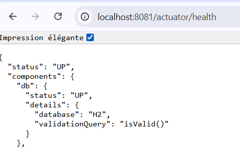
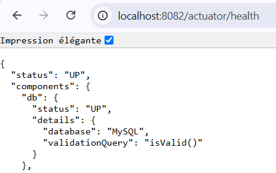
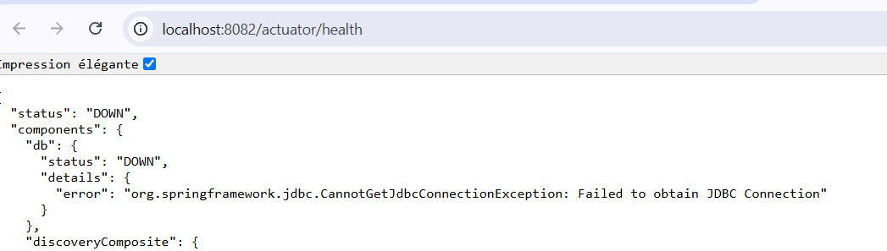
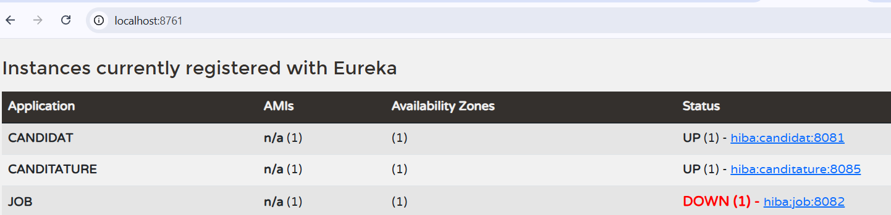
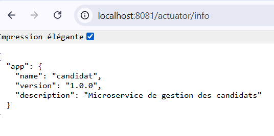
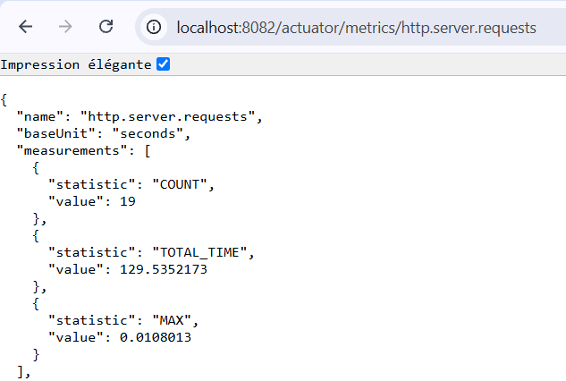
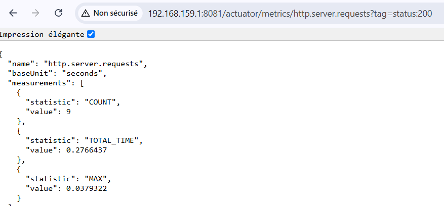
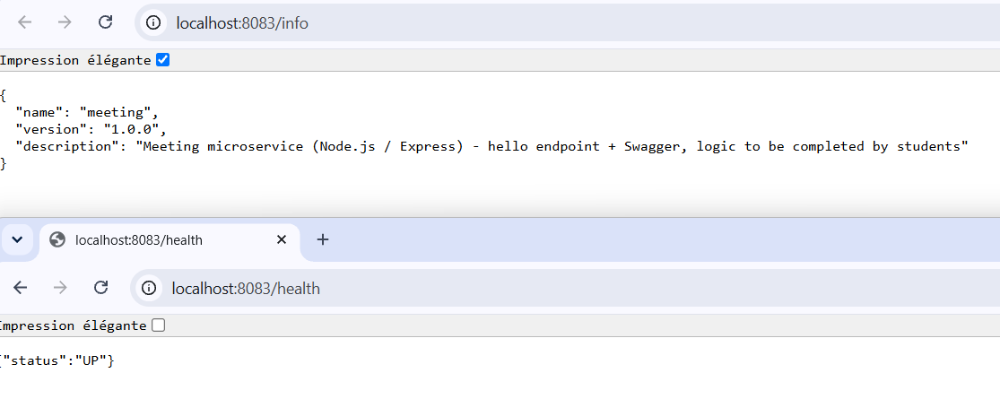
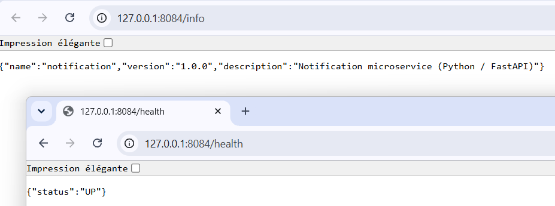
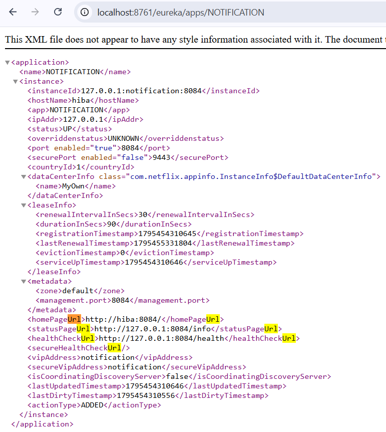

# Atelier Eureka – Architecture Web Distribuée

Année universitaire 2026-2027

## Équipe
- Hiba Ben Amara
-Leila Jendoubi
-Adem Hchicha
-Aziz Jouini

## Description
Mise en place d'un serveur de découverte **Eureka** (Spring Cloud Netflix) auquel
s'enregistrent des microservices écrits dans trois technologies différentes
(Spring Boot, Node.js, Python).

## Architecture

| Microservice | Technologie | Port | Nom dans Eureka |
|---|---|---|---|
| Eureka Server | Spring Boot | 8761 | – |
| Candidat | Spring Boot + H2 | 8081 | CANDIDAT |
| Job | Spring Boot + MySQL | 8082 | JOB |
| Candidature | Spring Boot | 8085 | CANDITATURE |
| Meeting | Node.js / Express | 8083 | MEETING |
| Notification | Python / FastAPI | 8084 | NOTIFICATION |

## Dashboard Eureka

Plusieurs instances sont lancées : CANDIDAT (8081, 8091), MEETING (8083, 8093)
et NOTIFICATION (8084, 8094).


## Lancement

1. **Eureka Server** : lancer la classe principale (port 8761), puis ouvrir http://localhost:8761
2. **Candidat, Job, Candidature** : lancer les applications Spring Boot (Job nécessite MySQL).
   Deuxième instance de Candidat : VM option `-Dserver.port=8091`.
3. **Meeting** :
   ```bash
   cd backend/microservices/meeting
   npm install
   npm start                       # port 8083
   $env:PORT=8093; npm start       # 2e instance (PowerShell)
   ```
4. **Notification** :
   ```bash
   cd backend/microservices/notification
   pip install -r requirements.txt
   python -m app.main                       # port 8084
   $env:PORT=8094; python -m app.main       # 2e instance (PowerShell)
   ```

## Vérification
- http://localhost:8761
- http://localhost:8083/api/meetings/hello
- http://localhost:8084/api/notifications/hello


## Observabilité avec Spring Boot Actuator (Prosit 2)

### Configuration
Dépendance `spring-boot-starter-actuator` ajoutée à **Candidat**, **Job** et **Candidature**,
avec ces propriétés dans `application.properties` :

```properties
management.endpoints.web.exposure.include=health,info,metrics
management.endpoint.health.show-details=always
eureka.client.healthcheck.enabled=true
management.info.env.enabled=true
info.app.name=...
info.app.version=1.0.0
info.app.description=...
```

### Endpoint /actuator/health
Santé de Candidat :



Santé de Job avec MySQL démarré (**UP**) :



### Panne de la base de données
MySQL arrêté : `/actuator/health` de Job passe en **DOWN** (code HTTP 503) et
le composant `db` indique l'erreur de connexion.



Dans le dashboard Eureka, l'instance JOB passe en **DOWN** grâce à
`eureka.client.healthcheck.enabled=true`. Après redémarrage de MySQL, Job repasse **UP**.



### Endpoint /actuator/info


### Endpoint /actuator/metrics
Après plusieurs appels à l'API de Candidat :



**Question : combien de requêtes HTTP Candidat a-t-il traitées ? Quelle est la durée de la requête la plus lente ? Que donne `?tag=status:200` ?**

- **COUNT** : 19 requêtes (ce nombre inclut aussi les appels à `/actuator/...`).
- **MAX** : 0.01 secondes pour la requête la plus lente.
- Avec `?tag=status:200` : COUNT = 9, c'est-à-dire seulement les requêtes réussies ;
  les autres sont des erreurs (404, etc.).



### Santé de Meeting (Node.js)
Routes `GET /health` et `GET /info` ajoutées dans `src/app.js`, et déclarées dans
`eureka-js-client` via `healthCheckUrl` et `statusPageUrl`.



### Santé de Notification (Python / FastAPI)
Routes `GET /health` et `GET /info` ajoutées dans `app/main.py`, déclarées dans
`eureka_client.init_async` via `health_check_url` et `status_page_url`.



Registre Eureka (`/eureka/apps/NOTIFICATION`) avec les deux URL :

